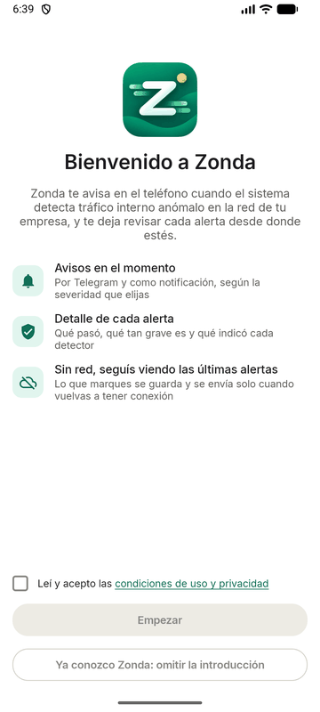
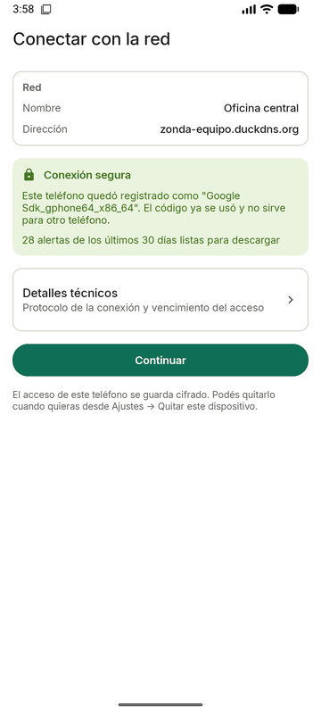
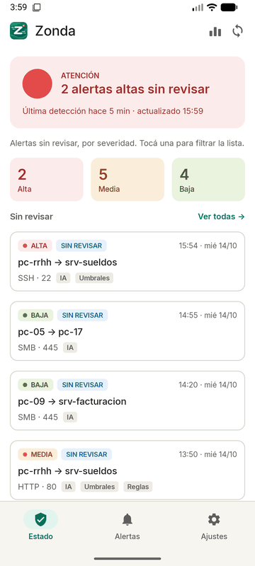
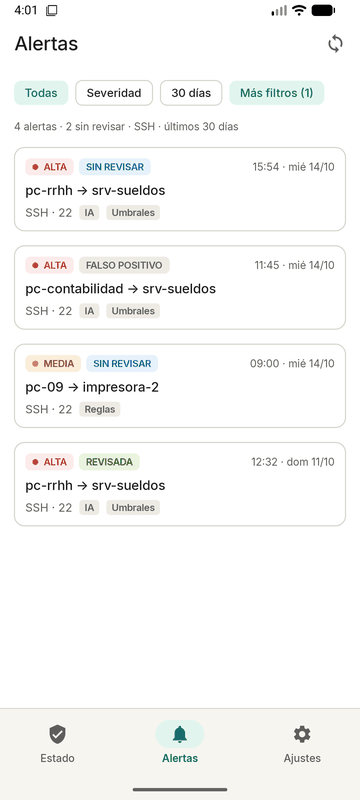
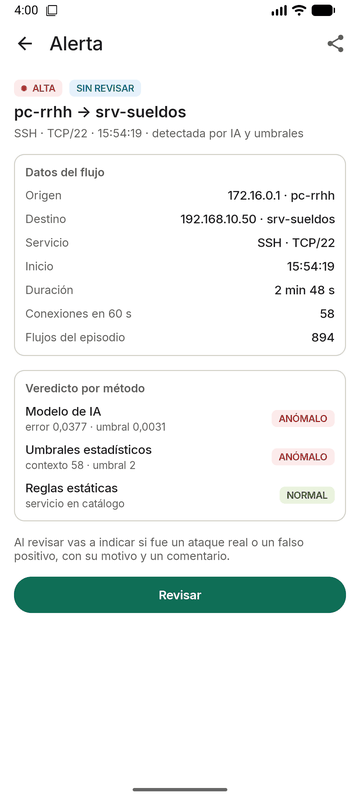
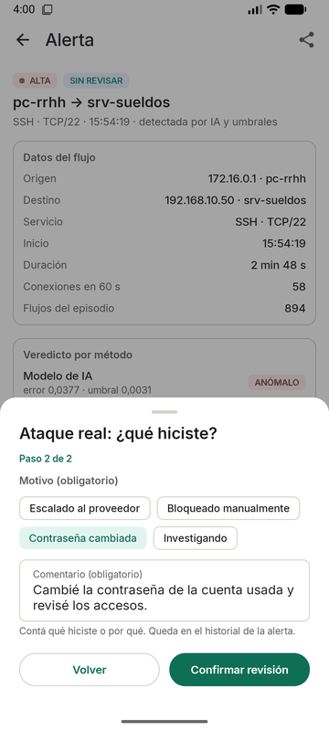
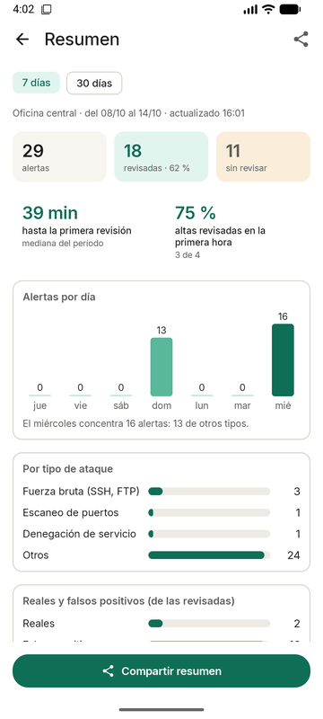
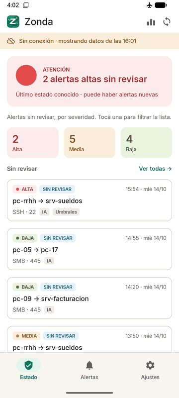
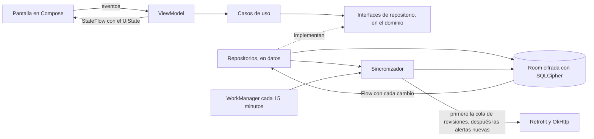
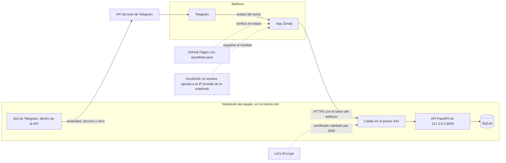

# Zonda

App Android de alertas de anomalías de red para PyMEs. Es el cliente móvil de una plataforma de detección desarrollada por el equipo: recibe las alertas de tráfico interno anómalo, muestra el estado de la red con un semáforo, permite recorrer las alertas, ver el detalle con el veredicto de tres métodos de detección y registrar la revisión (ataque real o falso positivo), todo con soporte sin conexión. El aviso inmediato llega por un bot de Telegram.

Trabajo Práctico Obligatorio de Desarrollo de Aplicaciones I (UADE, 2.º cuatrimestre 2026). Integrantes: Melinda Sellés, Rodrigo Nicolás Larrart y Taiel Vinograd.

**Estado (14/10/2026):** versión 1.0.0, con los siete requisitos funcionales implementados y probados en emuladores con Android 8 y Android 16. Antes de la entrega faltan la prueba en un teléfono real con Telegram y HTTPS, la prueba con usuarios externos (semana del 26/10) y reemplazar las alertas de ejemplo por la exportación real de la plataforma.

## Capturas

| Bienvenida | Pareo por HTTPS | Estado | Alertas |
|:---:|:---:|:---:|:---:|
|  |  |  |  |
| **Detalle** | **Revisión** | **Resumen** | **Sin conexión** |
|  |  |  |  |

Capturas del APK de release en el emulador, con las alertas de ejemplo.

## Qué hace

El escenario principal es el del informe de la Etapa 1: Martín, administrador de IT de una PyME, recibe por Telegram "Alerta ALTA · SSH", toca el aviso y la app abre el detalle de esa alerta; ve que el modelo de IA y los umbrales marcan tráfico anómalo, la revisa como ataque real con su motivo y un comentario, aunque en la sala de servidores no tenga señal, y la revisión se envía sola cuando vuelve la red. El lunes comparte el Resumen semanal con el dueño de la empresa.

### Requisitos funcionales

| Requisito | Qué hace | Estado | Dónde se ve |
|---|---|---|---|
| RF01. Estado de la red | Semáforo de la red activa, alertas sin revisar por severidad (tocar un contador filtra la lista) y hora de los datos. Sin datos, el semáforo queda gris y nunca en verde | Hecho | Pestaña Estado |
| RF02. Lista de alertas | Todas las alertas guardadas, con el estado de revisión de cada una y filtros por estado, severidad, período, servicio, equipo destino y método | Hecho | Pestaña Alertas |
| RF03. Detalle | Datos del flujo y veredicto de los tres métodos (modelo de IA, umbrales estadísticos y reglas estáticas). Se abre desde el aviso de Telegram, también si la alerta todavía no está en el teléfono | Hecho. El aviso real de Telegram falta probarlo en un teléfono; en el emulador se probó con un Telegram simulado | Tocar una alerta o el botón del aviso |
| RF04. Revisión | Ataque real o falso positivo, con motivo y comentario obligatorios, 5 segundos para deshacer, sin conexión (se envía al volver la red), historial, cambiar la revisión y conflicto si otra persona la revisó antes | Hecho | Revisar, en el detalle |
| RF05. Primer inicio y pareo | Bienvenida con las condiciones de uso, tutorial que se puede omitir, avisos por severidad, severidad de cada tipo de ataque, pareo con QR o a mano, Telegram (se puede posponer) y un recorrido de once pasos | Hecho | La primera vez que se abre la app |
| RF06. Varias redes y severidad | Parear más de una red y elegir la activa, con los datos de cada una por separado; severidad de cada tipo de ataque; Quitar este dispositivo | Hecho | Ajustes |
| RF07. Resumen | 7 o 30 días: alertas por día y por tipo, reales y falsos positivos, las dos métricas de éxito, cobertura y precisión de cada método. Tocar una cifra recalcula todo. Se comparte como imagen sin IP ni nombres de equipos | Hecho | Ícono de barras en Estado |

### Requisitos no funcionales

| Requisito | Cómo se cumple |
|---|---|
| RNF01. Sin conexión | Estado, lista, detalle y Resumen salen de la base local; un banner dice de qué hora son los datos |
| RNF02. Privacidad | Por Telegram viajan solo la severidad, el servicio y la hora (una prueba del backend controla que ningún aviso tenga una IP o un nombre de equipo); el Resumen compartido lleva solo cantidades |
| RNF03. Datos locales | Room cifrada con SQLCipher, alertas de hasta 30 días, token y clave de la base protegidos con el Keystore, sin copia de seguridad (`allowBackup="false"`) y Borrar datos locales en Ajustes |
| RNF04. Cifrado en tránsito | El release habla solo HTTPS en todas las versiones de Android, con solo las autoridades del sistema; Caddy acepta TLS 1.2 y 1.3 con un certificado de Let's Encrypt. Si la verificación falla, la app no manda el código ni el token |
| RNF05. Usabilidad | Cada pantalla de datos tiene carga, contenido, vacío, error y sin conexión, con un mensaje que dice qué hacer |
| RNF06. Recuperación ante errores | Sin permiso de cámara se parea a mano; sin permiso de notificaciones avisa solo Telegram; cada error ofrece Reintentar |
| RNF07. Rendimiento | Con 500 alertas guardadas, Estado aparece en menos de 1 segundo (prueba con Room). En el emulador, con 1.008 alertas, el Resumen de 30 días ya estaba en pantalla medio segundo después del toque. Falta medirlo en un teléfono real |
| RNF08. Batería | WorkManager sincroniza cada 15 minutos solo con red, con reintentos espaciados. Con la app abierta se consulta al abrirla, al volver la conexión o cuando la persona lo pide; la única consulta repetida es cada 3 segundos mientras se espera que toque Iniciar en Telegram |
| RNF09. Accesibilidad | La severidad va con color, punto y texto; los botones tienen un área táctil de 48 dp; los textos de ayuda tienen contraste AA y la letra sigue el tamaño del sistema |
| RNF10. Mantenibilidad | Capas separadas, pruebas automáticas en la app y en el backend, y ningún secreto en el repositorio |
| RNF11. Compatibilidad | Android 8.0 (API 26) o superior; probada en emuladores con Android 8.0 y Android 16. Falta el teléfono real |
| RNF12. Control de acceso | Token propio por teléfono y por red, emitido al canjear el código de pareo, que vence a los 90 días y se revoca con `zonda revoke`; ante un 401 la app pide un pareo nuevo sin borrar lo guardado |

## Cómo está organizado el repositorio

```
app/        La app Android (Kotlin, Jetpack Compose)
backend/    La API de alertas (FastAPI + SQLite), el bot de Telegram, Caddy y los scripts de la demo
docs/       Decisiones, guion de la demo, registro de uso de IA, capturas y los archivos del dominio del enlace del aviso
.github/    Integración continua y plantillas de issue y pull request
```

## Arquitectura

### La app

MVVM con las tres capas de Clean Architecture, en un solo módulo con un paquete por capa:

```
ar.edu.uade.zonda
├── ZondaApp.kt          Application: crea el contenedor, configura WorkManager y programa la sincronización
├── MainActivity.kt      única Activity; arma el tema y la navegación
├── di/                  AppContainer, contenedor manual de dependencias
├── domain/              modelos, reglas y casos de uso en Kotlin puro (sin Android)
├── data/                Room, Retrofit, Keystore, DataStore, mappers, repositorios y el sincronizador
├── sync/                el worker de sincronización en segundo plano y la conectividad
├── notificaciones/      la notificación local de alertas altas nuevas
└── ui/                  pantallas en Compose, ViewModels, navegación, tema y componentes
```

Los datos circulan así: la pantalla emite eventos, el ViewModel llama a un caso de uso, el caso de uso habla con la interfaz del repositorio, y la implementación decide entre la base local (Room) y la API (Retrofit). La base local es la fuente de verdad de la interfaz: la red solo la actualiza, y como Room avisa cada cambio con un `Flow`, la pantalla se actualiza sola.



La única flecha que sube es la punteada: la capa de datos depende de las interfaces del dominio y no al revés. Por eso los casos de uso se prueban con repositorios en memoria, sin base ni red.

### Infraestructura



La API no queda expuesta a internet: el nombre de DuckDNS apunta a la IP privada de la notebook y Let's Encrypt comprueba que el nombre es nuestro con un registro DNS que escribe Caddy. El detalle de cada pieza está en [backend/README.md](backend/README.md).

## Cómo ejecutarla

Hace falta Android Studio 2026.1 o más nuevo (trae el JDK) y, para el backend, Python 3.12. Los scripts de la demo son de Windows (PowerShell).

### App (debug)

1. Abrir la carpeta del repositorio con Android Studio y esperar la sincronización de Gradle.
2. Elegir un emulador o un teléfono con Android 8.0 o superior y tocar Run.

Desde la terminal: `.\gradlew.bat assembleDebug`. El build de debug puede usar la API local sin HTTPS: desde el emulador se parea con `http://10.0.2.2:8000`, y desde un teléfono por USB, después de `adb reverse tcp:8000 tcp:8000`, con `http://127.0.0.1:8000`. El de release no.

### APK de release firmado

El release se firma con una clave del equipo que no está en el repositorio (decisión 28). En la computadora que firma, `%USERPROFILE%\.gradle\gradle.properties` tiene la línea `zonda.firma=<ruta a firma.properties>`, y ese archivo dice:

```
archivo=zonda-release.jks
alias=zonda
contrasenia=<la contraseña de la clave>
```

Con eso, `.\gradlew.bat assembleRelease` deja el APK firmado en `app\build\outputs\apk\release\app-release.apk`. Sin la propiedad, como en el CI, sale `app-release-unsigned.apk`, que compila pero Android no instala. Para instalarlo: `adb install app\build\outputs\apk\release\app-release.apk` (si el teléfono tenía la versión de debug, desinstalarla antes: tiene otra firma). El APK de release solo se conecta por HTTPS, así que se usa con la demo.

### Backend

```powershell
cd backend
python -m venv .venv
.venv\Scripts\pip install -r requirements.txt
.venv\Scripts\python -m uvicorn app.main:app --host 127.0.0.1 --port 8000 --reload
```

Así corre sin HTTPS, para desarrollo. Al arrancar con la base vacía carga las alertas de muestra y corre sus fechas para que la más reciente sea de hace una hora. Para parear un teléfono: `.\zonda.cmd pair` (muestra el QR y el código). Las variables de entorno, el contrato de la API y el bot están en [backend/README.md](backend/README.md).

### La demo con HTTPS

1. Copiar `backend\.env.ejemplo` como `backend\.env` y completar `ZONDA_DOMINIO` y `DUCKDNS_TOKEN` (un nombre de DuckDNS) y `TELEGRAM_BOT_TOKEN` (un bot creado con BotFather). `.env` no se sube al repositorio.
2. Descargar Caddy para Windows con el módulo `caddy-dns/duckdns` en `backend\caddy\caddy.exe`.
3. En `backend`, `.\demo.cmd`: apunta el nombre a la notebook, arranca la API con el bot y Caddy, y espera hasta que la API responde por HTTPS. Ctrl+C cierra todo.

Paso a paso, con qué mostrar y qué decir: [docs/guion_demo.md](docs/guion_demo.md).

### Pruebas

```powershell
.\gradlew.bat testDebugUnitTest
cd backend
.venv\Scripts\python -m pytest
```

Con la demo levantada, `powershell -ExecutionPolicy Bypass -File backend\scripts\probar_tls.ps1` prueba el HTTPS: TLS 1.3 y 1.2 aceptados, 1.1 y 1.0 rechazados, certificado de Let's Encrypt válido para el nombre y por la IP no. La sincronización completa también se puede correr contra la API real desde la JVM, con un código de `zonda.cmd pair`:

```powershell
$env:ZONDA_API_URL = "http://127.0.0.1:8000"; $env:ZONDA_CODIGO_PAREO = "K7M2-QX9P"; .\gradlew.bat testDebugUnitTest --tests "*ContraBackend*"
```

## Tecnologías

| Tecnología | Para qué | Por qué |
|---|---|---|
| Kotlin + Jetpack Compose (Material 3) | Toda la interfaz | Stack de la materia; una sola Activity y pantallas declarativas |
| Navigation Compose | Barra inferior, pila de pantallas y enlace del aviso | Resuelve el App Link sin código propio |
| ViewModel + StateFlow | Estado de cada pantalla | Sobrevive a la rotación y separa la lógica de la pantalla |
| Room + SQLCipher | Caché local de alertas, redes y acciones pendientes | Base del funcionamiento sin conexión, cifrada; consultas reactivas con Flow |
| Retrofit + OkHttp + Gson | Cliente de la API | Interfaz declarativa, interceptor para el token |
| DataStore | Preferencias | Reemplazo moderno de SharedPreferences |
| Android Keystore | Token de cada red y clave de la base | El secreto no sale del almacenamiento seguro del teléfono |
| WorkManager | Sincronización cada 15 minutos | Respeta las restricciones de batería de Android |
| CameraX + ML Kit | Lectura del QR de pareo | Lee el código en el teléfono, con el modelo incluido en la app |
| FastAPI + SQLite | API de alertas | Mínima, en Python, sin servidor de base de datos aparte |
| Caddy + Let's Encrypt + DuckDNS | HTTPS del servidor | Certificado gratuito que Android reconoce, sin abrir la notebook a internet |
| API de bots de Telegram | Aviso inmediato | Gratuita, recomendada por la cátedra |
| JUnit 4, Turbine, Robolectric, MockWebServer y pytest | Pruebas | Casos de uso, ViewModels, Room, pantallas y red sin emulador; el backend con su cliente de pruebas |

Las dependencias y sus versiones están en `gradle/libs.versions.toml`.

## Decisiones relevantes

Están en [docs/decisiones.md](docs/decisiones.md), cada una con su porqué y la alternativa descartada. Las principales:

1. Kotlin y Jetpack Compose en lugar de React Native, que proponía la Etapa 1.
2. Contenedor manual de dependencias en lugar de Hilt.
3. Una alerta es un episodio (flujos agrupados por origen y destino), no un flujo de red.
4. Cada alerta trae un tipo de ataque que define la severidad; ninguna alerta se oculta.
5. Sin fijación de certificado: alcanza con la verificación de Android y las autoridades del sistema.
6. Las alertas de muestra salen de CICIDS2017; sus fechas se corren para la demo.
7. Revisión con Deshacer antes de enviar, cola de acciones con identificador propio y conflicto resuelto por la persona (decisión 15).
8. HTTPS en todas las versiones de Android, también en la 8, y la demo con un solo comando (decisión 26).
9. El release se firma con una clave propia que vive fuera del repositorio (decisión 28).

## Cómo se probó

- **Pruebas automáticas:** 352 en la app (una se saltea porque necesita la API real) y 52 en el backend. Cubren los casos de uso, los ViewModels, Room con sus migraciones, el cliente HTTP con un servidor de mentira, las pantallas con Compose sobre Robolectric y todas las rutas de la API, incluido el bot con un Telegram falso.
- **Integración continua:** GitHub Actions compila la app (debug y release sin firmar) y corre las pruebas de la app y del backend en cada pull request.
- **Emuladores:** cada fase se probó en un emulador con Android 16 contra la API local. La versión 1.0.0 firmada se probó en Android 16 y en Android 8.0 contra la API publicada con HTTPS: pareo (TLS 1.3 y TLS 1.2), enlace del aviso verificado, revisión, sin conexión, Resumen y red tranquila.
- **HTTPS:** `probar_tls.ps1` contra la API publicada, con las siete pruebas en PASA; por la IP en lugar del nombre, la app no manda nada.
- **Rendimiento:** Estado con 500 alertas en la prueba con Room, y la app con 1.008 alertas en el emulador.
- **Falta:** la prueba en un teléfono real con Telegram y el hotspot, y la prueba con usuarios externos.

## Limitaciones conocidas

- **Las alertas son de ejemplo.** La API sirve 28 episodios armados con la forma de CICIDS2017; la exportación real de la plataforma se carga sin cambiar nada más (backend, "Datos de muestra").
- **La API es una muestra.** Corre en la notebook del equipo, una API por red, sin interfaz de administración (el pareo y la revocación son comandos).
- **Riesgo de la red.** Algunos routers bloquean los nombres públicos que apuntan a una IP privada; por eso la demo usa el hotspot de un teléfono. Fuera de la oficina, la API se alcanza solo por la VPN de la empresa.
- **El aviso depende de Telegram.** Sin internet no llega; la notificación propia de la app aparece cuando sincroniza, cada 15 minutos o más (Android puede demorarla). Si el navegador interno de Telegram abre la página en lugar de la app, la página ofrece "Abrir en Zonda".
- **Sin fijación de certificado** (decisión 5): se confía en las autoridades del sistema.
- **Un solo canal de notificación** en el teléfono, y el sonido de Telegram se configura desde el chat del bot.
- **Recall y F1** no se calculan en la app: necesitan datos etiquetados y se miden fuera de ella.
- **Solo Android.** No hay versión para iOS.
- **APK sin achicar:** el release no usa R8 y pesa unos 49 MB (decisión 28).
- **Sin pruebas instrumentadas:** las pantallas se prueban en la JVM con Robolectric y a mano en los emuladores.

## Forma de trabajo

- GitHub Flow: `main` siempre compila; todo cambio entra por pull request con revisión de otro integrante.
- Una rama `feature/tema` por fase y commits chicos con prefijos `feat:`, `fix:`, `docs:`, `test:`, `chore:`, `ci:`.
- Cada pull request responde, para cada pieza importante, las seis preguntas de la consigna.
- Ningún token ni clave en el repositorio: van en `backend/.env` y en la computadora que firma el APK.
- Uso de asistentes de IA: ver [docs/prompts/README.md](docs/prompts/README.md).

## Licencia

MIT. Ver [LICENSE](LICENSE).
